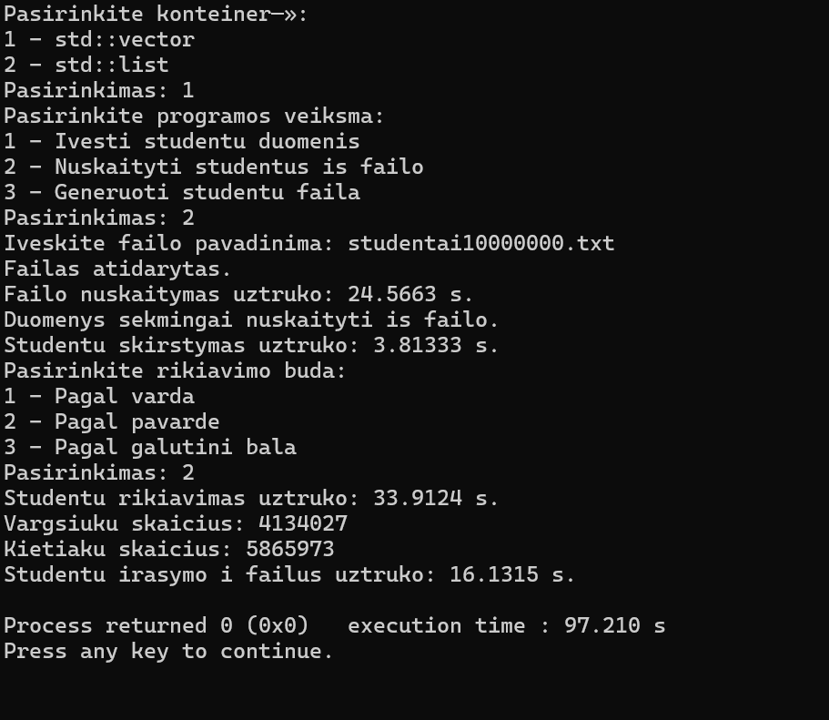
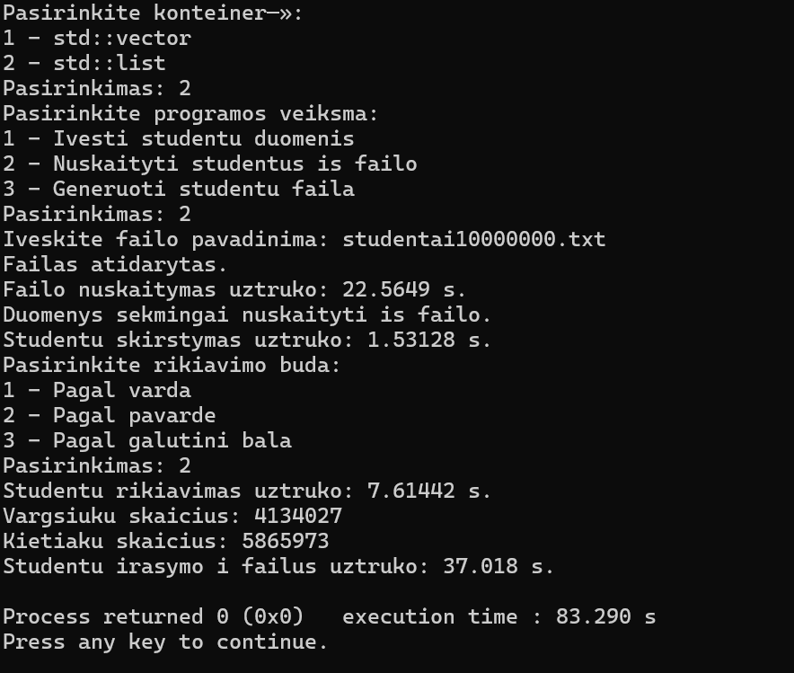

# Pirmas.Projektas

Apie programa:
Tai C++ programa, skirta studentų duomenims apdoroti ir jų galutiniams pažymiams apskaičiuoti.
Galutinis pažymys apskaičiuojamas pagal formulę: Galutinis = 0,4 * namų darbų vidurkis + 0,6 * egzamino pažymys.
Programa taip pat gali apskaičiuoti galutinį pažymį naudojant namų darbų medianą.

Programa leidžia:
- Įvesti studentų duomenis rankiniu būdu.
- Atsitiktinai generuoti studentų pažymius.
- Nuskaityti studentų duomenis iš tekstinio failo.
- Generuoti tekstinius failus su pasirinktu studentų kiekiu.
- Suskirstyti studentus į dvi grupes pagal galutinį pažymį.
- Rikiuoti studentus pagal vardą, pavardę arba galutinį pažymį.
- Išsaugoti suskirstytus studentus atskiruose tekstiniuose failuose.
- Išmatuoti pagrindinių duomenų apdorojimo operacijų trukmę.

Versija 0.2
Šioje versijoje pridėta:

1. Studentų failų generavimas su 1 000, 10 000, 100 000, 1 000 000 ir 10 000 000 įrašų.
2. Studentų skirstymas į dvi grupes:
   - Vargsiukai – galutinis pažymys mažesnis nei 5,0.
   - kietiakiai – galutinis pažymys ne mažesnis nei 5,0.
3. Abiejų grupių išsaugojimas failuose `vargsiukai.txt` ir `kietiakiai.txt`.
4. Rikiavimas pagal vartotojo pasirinktą kriterijų.
5. Failo nuskaitymo, studentų skirstymo, rūšiavimo ir rezultatų įrašymo laiko matavimas.
6. Programos kodo suskirstymas į antraštinius (`.h`) ir realizacijos (`.cpp`) failus.
7. Studentų perkėlimas į grupes naudojant `std::move()`.

Programos paaleidimas:
Programai reikalingas C++ kompiliatorius, pavyzdžiui, `g++`.
Kompiliavimas:

g++ -std=c++11 pagrindinis.cpp funkcijos.cpp -o programa

Paleidimas:
./programa

Paleidus programą, galima pasirinkti vieną iš trijų veiksmų:

- `1` – įvesti studentų duomenis.
- `2` – nuskaityti studentus iš failo.
- `3` – sugeneruoti studentų failą.

Pasirinkus failo nuskaitymą, programa paprašo įvesti failo pavadinimą ir pasirinkti rūšiavimo būdą:

- `1` – pagal vardą.
- `2` – pagal pavardę.
- `3` – pagal galutinį pažymį.

Našumo tyrimas:

Buvo naudojami penki skirtingo dydžio studentų duomenų failai. Kiekvienas failas buvo apdorotas 3 kartus, pasirinkus rūšiavimą pagal galutinį pažymį.

Atskirai matuotas:

- Failo nuskaitymas.
- Studentų skirstymas į grupes.
- Studentų rūšiavimas.
- Rezultatų įrašymas į du failus.

Toliau pateikiami trijų bandymų laikų aritmetiniai vidurkiai sekundėmis.

| Studentų kiekis | Nuskaitymas (s) | Skirstymas (s) | Rūšiavimas (s) | Įrašymas (s) |
|---|---:|---:|---:|---:|
| 1 000 | 0,00897 | 0,00055 | 0,00334 | 0,06921 |
| 10 000 | 0,04304 | 0,00582 | 0,04162 | 0,02209 |
| 100 000 | 0,25539 | 0,04008 | 0,39605 | 0,17118 |
| 1 000 000 | 2,27400 | 0,44161 | 5,36025 | 1,80220 |
| 10 000 000 | 23,93310 | 4,07036 | 67,51763 | 17,40193 |

Tyrimo išvados:

Didėjant studentų kiekiui, ilgėja duomenų nuskaitymo, skirstymo, rūšiavimo ir įrašymo laikas.
Didžiausiems failams daugiausia laiko užtruko studentų rūšiavimas pagal galutinį pažymį.
Mažų failų matavimo rezultatai labiau svyravo, nes trumpoms operacijoms didesnę santykinę įtaką gali turėti operacinės sistemos ir disko apkrova.
Programa sėkmingai apdorojo visus penkis failų dydžius, įskaitant 10 000 000 studentų.

Pastabos:

Dideli sugeneruoti duomenų failai nėra būtini programos kodui saugoti GitHub saugykloje. Juos galima sugeneruoti naudojant trečiąjį programos meniu pasirinkimą.
Ateities versijose galima toliau optimizuoti programos atminties naudojimą ir duomenų apdorojimo spartą.

## Versija 0.3

Šioje versijoje atliktas `std::vector` ir `std::list` konteinerių našumo palyginimas.

### Pagrindiniai pakeitimai

1. Pridėta galimybė programos pradžioje pasirinkti konteinerį:
   - `1` – `std::vector<studentas>`.
   - `2` – `std::list<studentas>`.
2. Abu konteineriai naudojami studentų duomenims nuskaityti, skirstyti, rūšiuoti ir rezultatams įrašyti.
3. `std::vector` studentai į grupes perkeliami naudojant `std::move()`.
4. `std::list` studentai į grupes perkeliami naudojant `splice()`.
5. `std::vector` rūšiuojamas naudojant `std::sort()`, o `std::list` – `list.sort()`.
6. Rankiniu būdu įvedant studentų duomenis, išvedamas studento objekto atminties adresas.
7. Atliktas abiejų konteinerių našumo tyrimas su penkiais skirtingo dydžio duomenų failais.

### Testavimo kompiuteris

| Komponentas | Specifikacija |
|---|---|
| Procesorius | Snapdragon X 12-core X1E80100 |
| Procesoriaus dažnis | 3,40 GHz |
| Procesoriaus branduoliai | 12 |
| Operatyvioji atmintis | 16 GB LPDDR5 |
| RAM greitis | 8448 MT/s |
| Diskas | NVMe SSD |
| Operacinė sistema | Windows |

### Našumo tyrimo metodika

Buvo lyginami `std::vector<studentas>` ir `std::list<studentas>` konteineriai.

Naudoti penki duomenų failų dydžiai: 1 000, 10 000, 100 000, 1 000 000 ir 10 000 000 studentų.

Kiekvienas failas buvo apdorotas po tris kartus su kiekvienu konteineriu, naudojant tuos pačius pradinius duomenis.

Visuose `v0.3` bandymuose studentai rūšiuoti pagal pavardę.

Atskirai matuotos keturios operacijos:
- Duomenų nuskaitymas iš failo.
- Studentų skirstymas į vargšiukus ir kietiakus.
- Abiejų grupių rūšiavimas.
- Rezultatų įrašymas į failus.

Lentelėse pateikiami trijų bandymų aritmetiniai vidurkiai sekundėmis. Bendra trukmė apskaičiuota sudėjus keturių matuotų operacijų laikus. Vartotojo pasirinkimų įvedimo laikas neįtrauktas.

### v0.3 našumo tyrimo rezultatai

Toliau pateikiami trijų bandymų aritmetiniai vidurkiai sekundėmis. Abiem konteineriams naudoti tie patys pradiniai failai, o studentai rūšiuoti pagal pavardę.

#### `std::vector` rezultatai

| Studentų kiekis | Nuskaitymas (s) | Skirstymas (s) | Rūšiavimas (s) | Įrašymas (s) | Iš viso (s) |
|---|---:|---:|---:|---:|---:|
| 1 000 | 0.013502 | 0.001334 | 0.002523 | 0.007550 | 0.024909 |
| 10 000 | 0.032267 | 0.004813 | 0.028066 | 0.024028 | 0.089174 |
| 100 000 | 0.241075 | 0.049694 | 0.319308 | 0.162798 | 0.772875 |
| 1 000 000 | 2.224707 | 0.408699 | 3.233653 | 1.658493 | 7.525552 |
| 10 000 000 | 23.797733 | 3.921900 | 33.888500 | 16.361067 | 77.969200 |

#### `std::list` rezultatai

| Studentų kiekis | Nuskaitymas (s) | Skirstymas (s) | Rūšiavimas (s) | Įrašymas (s) | Iš viso (s) |
|---|---:|---:|---:|---:|---:|
| 1 000 | 0.004267 | 0.000402 | 0.000618 | 0.016526 | 0.021813 |
| 10 000 | 0.032968 | 0.001950 | 0.007142 | 0.057715 | 0.099775 |
| 100 000 | 0.246004 | 0.017517 | 0.063136 | 0.395943 | 0.722600 |
| 1 000 000 | 2.227920 | 0.157941 | 0.633990 | 3.734443 | 6.754294 |
| 10 000 000 | 22.328300 | 1.543723 | 7.656810 | 37.861533 | 69.390366 |

#### Bendros trukmės palyginimas

| Studentų kiekis | `std::vector` (s) | `std::list` (s) | Greitesnis konteineris |
|---|---:|---:|---|
| 1 000 | 0.024909 | 0.021813 | `list` |
| 10 000 | 0.089174 | 0.099775 | `vector` |
| 100 000 | 0.772875 | 0.722600 | `list` |
| 1 000 000 | 7.525552 | 6.754294 | `list` |
| 10 000 000 | 77.969200 | 69.390366 | `list` |

### v0.3 tyrimo išvados

1. Didėjant studentų skaičiui, abiejų konteinerių apdorojimo trukmė ilgėjo.
2. `std::list` skirstymo operacija visuose atliktuose bandymuose buvo greitesnė. Tam įtakos turi naudojama `splice()` funkcija, leidžianti perkelti sąrašo elementus nekopijuojant studentų objektų.
3. `std::list` rūšiavimas pagal pavardę visuose atliktuose bandymuose buvo greitesnis nei `std::vector` rūšiavimas.
4. `std::vector` visuose bandymuose greičiau įrašė suskirstytus studentus į tekstinius failus.
5. Apdorojant 10 000 000 studentų, vidutinė bendra `vector` trukmė buvo apie 77,97 s, o `list` – apie 69,39 s.
6. Tyrimas parodė, kad konteinerio našumas priklauso nuo atliekamos operacijos. Vienas konteineris nebūtinai yra greičiausias visais atvejais.
7. Mažų failų rezultatai gali labiau svyruoti dėl sistemos apkrovos, disko talpyklos ir kitų aplinkybių.

### v0.3 našumo tyrimo ekrano nuotraukos

Toliau pateikiami 10 000 000 studentų apdorojimo rezultatai naudojant abu konteinerius.

**std::vector rezultatai:**



**std::list rezultatai:**



# Versija 1.0

## Pagrindiniai pakeitimai

Šioje versijoje įgyvendintos ir palygintos trys studentų skirstymo į vargšiukus ir kietiakus strategijos, naudojant `std::vector` ir `std::list` konteinerius.

Programa leidžia pasirinkti:

- Konteinerį: `std::vector` arba `std::list`.
- Vieną iš trijų studentų skirstymo strategijų.
- Studentų duomenų įvedimą, nuskaitymą iš failo arba failo generavimą.
- Rikiavimą pagal vardą, pavardę arba galutinį pažymį.

### 1 strategija – kopijavimas į du konteinerius

Sukuriami du nauji konteineriai: `vargsiukai` ir `kietiakiai`.

Studentai pagal galutinį pažymį nukopijuojami į atitinkamą konteinerį. Pradinis `studentai` konteineris lieka nepakeistas.

### 2 strategija – vienas papildomas konteineris

Sukuriamas tik `vargsiukai` konteineris.

- `std::vector` atveju vargšiukai perkeliami į naują konteinerį, o iš pradinio šalinami naudojant `erase()`.
- `std::list` atveju naudojamas `splice()`, leidžiantis perkelti elementus nekopijuojant studentų objektų.

Pradiniame konteineryje lieka kietiakai.

### 3 strategija – optimizuotas skirstymas

Trečioji strategija skirta pagerinti antrosios strategijos efektyvumą.

- `std::vector` naudojamas `std::stable_partition()`, `std::make_move_iterator()` ir vienkartinis elementų intervalo pašalinimas naudojant `erase()`.
- `std::list` naudojamas `splice()`, nes ši operacija leidžia efektyviai perkelti sąrašo elementus.

`std::list` antroji ir trečioji strategijos naudoja iš esmės tą patį skirstymo būdą, todėl jų vykdymo laikai yra panašūs.

## Našumo tyrimo metodika

Testavimas atliktas tuo pačiu kompiuteriu, kuris naudotas `v0.3` tyrime:

| Komponentas | Specifikacija |
|---|---|
| Procesorius | Snapdragon X 12-core X1E80100 |
| Dažnis | 3,40 GHz |
| RAM | 16 GB LPDDR5 |
| RAM greitis | 8448 MT/s |
| Diskas | NVMe SSD |
| Operacinė sistema | Windows |

Naudoti keturi duomenų failų dydžiai:

- 10 000 studentų.
- 100 000 studentų.
- 1 000 000 studentų.
- 10 000 000 studentų.

Visuose bandymuose naudoti tie patys atitinkamo dydžio pradiniai duomenų failai, o studentai rūšiuoti pagal pavardę.

Buvo matuojamas studentų skirstymo į dvi grupes laikas.

Mažesnių duomenų rinkinių bandymai kartoti, o 10 milijonų studentų rinkiniui atliktas vienas kiekvienos išbandytos kombinacijos matavimas.

## v1.0 našumo tyrimo rezultatai

Lentelėse pateikti skirstymo laikai sekundėmis. Mažesnė reikšmė reiškia greitesnį skirstymą.

### 10 000 studentų

| Konteineris | 1 strategija | 2 strategija | 3 strategija |
|---|---:|---:|---:|
| `std::vector` | 0,006548 | 2,190730 | 0,005560 |
| `std::list` | 0,006196 | 0,001700 | 0,002143 |

Pateikti dviejų naujausių bandymų vidurkiai.

### 100 000 studentų

| Konteineris | 1 strategija | 2 strategija | 3 strategija |
|---|---:|---:|---:|
| `std::vector` | 0,049056 | — | 0,053861 |
| `std::list` | 0,056017 | 0,018547 | 0,013883 |

Pateikti trijų bandymų vidurkiai.

### 1 000 000 studentų

| Konteineris | 1 strategija | 2 strategija | 3 strategija |
|---|---:|---:|---:|
| `std::vector` | 0,512343 | — | 0,500251 |
| `std::list` | 0,451928 | 0,128858 | 0,124129 |

Pateikti trijų bandymų vidurkiai.

### 10 000 000 studentų

| Konteineris | 1 strategija | 2 strategija | 3 strategija |
|---|---:|---:|---:|
| `std::vector` | 4,715320 | — | 4,410240 |
| `std::list` | 4,407810 | 1,273200 | 1,219780 |

Pateikti trijų bandymų rezultatai.

`std::vector` antroji strategija su didesniais failais nebuvo testuojama dėl pakartotinio `erase()` naudojimo. Ši operacija gali reikalauti perstumti daugybę elementų, todėl bendras skirstymo laikas gali labai padidėti.

## Tyrimo išvados

1. Pirmoji strategija yra paprasta, tačiau reikalauja papildomos atminties, nes studentai kopijuojami į du naujus konteinerius, išsaugant pradinį.
2. Antroji `std::vector` strategija pasirodė neefektyvi dėl kartotinio elementų šalinimo iš konteinerio vidurio.
3. Trečioji `std::vector` strategija reikšmingai pagerino skirstymo greitį, palyginti su antrąja strategija. Naudojant `std::stable_partition()` išvengiama pakartotinio kiekvieno vargšiuko šalinimo.
4. `std::list` antroji ir trečioji strategijos buvo greitesnės už pirmąją, nes `splice()` leidžia perkelti elementus nekopijuojant studentų objektų.
5. Apdorojant 10 000 000 studentų, greičiausiai iš išbandytų variantų veikė trečioji `std::list` strategija – 1,219780 s.
6. Rezultatai parodė, kad skirtingų konteinerių ir algoritmų efektyvumas priklauso nuo jų atliekamų operacijų. Mažesnių duomenų rinkinių rezultatai gali svyruoti dėl kompiuterio apkrovos ir kitų veiksnių.

## Programos kompiliavimas ir paleidimas

Projektui naudojamas C++17 standartas.

### Kompiliavimas naudojant g++

```bash
g++ -std=c++17 pagrindinis.cpp funkcijos.cpp -o programa
```

Paleidimas:

```bash
./programa
```

### Kompiliavimas naudojant CMake

Projekte yra `CMakeLists.txt` failas.

```bash
cmake -S . -B build
cmake --build build
```

Sukompiliuota programa bus `build` kataloge arba kompiliavimo sistemos sukurtame konfigūracijos poaplankyje.
